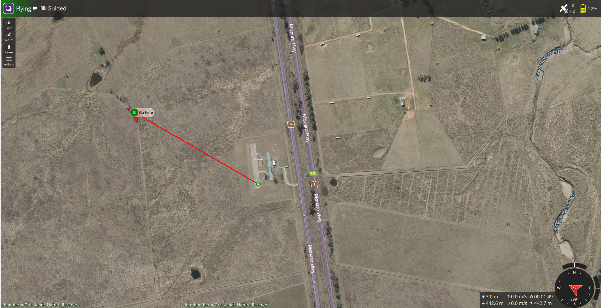
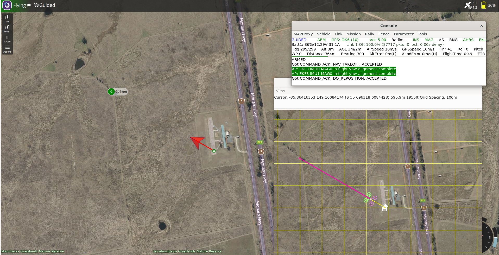
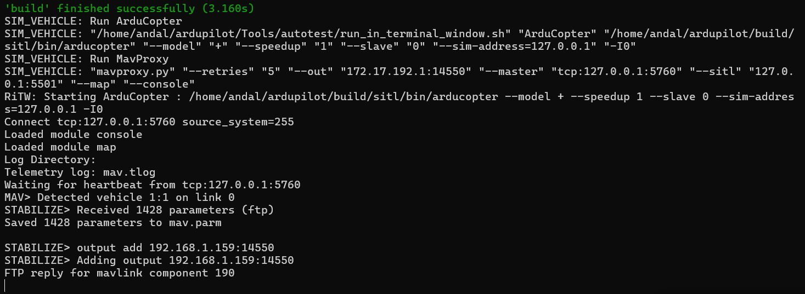
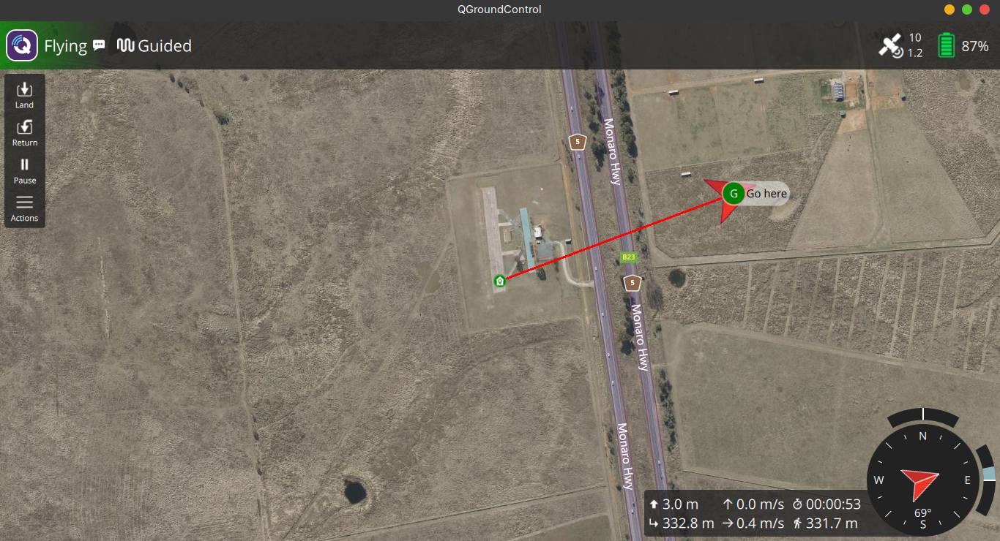

# UAV Ground Control Station Lab (ArduPilot SITL + QGroundControl)

A small lab where I set up a simulated drone and a Ground Control Station (GCS), first on one machine and then on two separate machines, connected through MAVLink, and documented the problems I ran into along the way.

I built it to understand how a GCS talks to a vehicle: the link, the ports, the telemetry and the commands. It is a learning project, not production work.

## What it does

- Runs an **ArduPilot Copter** simulator (SITL) on Ubuntu inside WSL2.
- Connects **QGroundControl** (the GCS) to it over **MAVLink / UDP**, either on the same PC or on a second Linux machine on the same network.
- From the GCS I can arm, take off, send the drone to a point on the map, and return it to launch.





## Setup

Environment: Windows 11 + WSL2, Ubuntu 24.04 (TODO: confirm with `lsb_release -a`).

**1. ArduPilot SITL** (inside WSL, Python virtual environment active):

```bash
cd ~/ardupilot/ArduCopter
sim_vehicle.py -v ArduCopter --console --map
```

**2. QGroundControl** (inside WSL, using the Linux AppImage and WSLg for the window):

```bash
sudo apt install -y libfuse2 libxcb-xinerama0 libxkbcommon-x11-0 libxcb-cursor0
wget https://d176tv9ibo4jno.cloudfront.net/latest/QGroundControl-x86_64.AppImage
chmod +x QGroundControl-x86_64.AppImage
./QGroundControl-x86_64.AppImage
```

**3. Point the telemetry at the GCS.** In the MAVProxy prompt:

```
output add 127.0.0.1:14550
```

QGroundControl connects automatically and shows the vehicle on the map.

## Two-machine setup

To get closer to a real setup, I separated the vehicle and the ground station:

- **Vehicle:** ArduPilot SITL on my PC (Ubuntu in WSL2).
- **GCS:** QGroundControl (Linux AppImage) on a separate Linux Mint laptop, on the same Wi-Fi network.

On the laptop I found its IP with `ip a`, and on the PC I added a second MAVProxy output pointing at it:

```
output add 192.168.1.159:14550
```

From the laptop I can arm, take off and send the vehicle to a point on the map, so commands reach the vehicle over the network as well as telemetry coming back.





### Firewall check

The laptop's firewall (`ufw`) denies incoming traffic by default, so I allowed MAVLink only from the vehicle PC:

```bash
sudo ufw allow from <pc-ip> to any port 14550 proto udp
```

To check that the rule is what lets the telemetry through, I tested without GUI using netcat on the laptop (`nc -ul 14550 | xxd | head`):

- **With the rule:** MAVLink v2 packets arrive (each starts with the `fd` marker).
- **Without the rule:** nothing arrives, and the kernel log shows the drop:

```
[UFW BLOCK] IN=wlp3s0 SRC=<pc-ip> DST=<laptop-ip> PROTO=UDP DPT=14550
```

## Problems I ran into (and how I fixed them)

| Problem | Cause | Fix |
|---|---|---|
| QGroundControl for Windows crashed on start with *Bad Image* (`gstreamer-1.0-0.dll`, error `0xc0e90002`) | Windows blocked a binary that is not recognised/signed, most likely Windows 11 Smart App Control | Did not disable the protection. Ran the Linux AppImage inside WSL instead |
| QGroundControl showed *Disconnected* although the simulator was running | `sim_vehicle.py` detected WSL and sent telemetry to the Windows host (`172.17.192.1:14550`), not to localhost where the GCS was running | Added a second output with `output add 127.0.0.1:14550` |
| `takeoff` failed in MAVProxy | The vehicle was not in `GUIDED` mode | Set the mode to `GUIDED` before arming and taking off |
| Telemetry did not reach the second machine | `ufw` on the laptop denies incoming traffic by default; the kernel log showed `[UFW BLOCK] ... SRC=<vehicle PC> DPT=14550` | Allowed UDP 14550 only from the vehicle PC's IP: `sudo ufw allow from <pc-ip> to any port 14550 proto udp` |

## What I learned

- A GCS is a client on a link: the interesting work is the link itself (ports, routing, firewalls, link quality), not the buttons.
- How to read what MAVProxy prints to work out where the telemetry is actually going.
- That a firewall on the GCS side can silently stop a working vehicle from being seen.
- How to document a problem so someone else can reproduce the fix.

## Next steps (planned, not done yet)

- Put the vehicle side on a Raspberry Pi instead of running the simulator on the PC.
- Add a WireGuard VPN between the two machines and point MAVProxy at the tunnel address.
- Measure latency and packet loss, simulate a link failure, and write up how I diagnosed it.

## Tech

ArduPilot SITL · MAVProxy · MAVLink · QGroundControl · WSL2 · Ubuntu · Linux Mint · UDP · ufw
